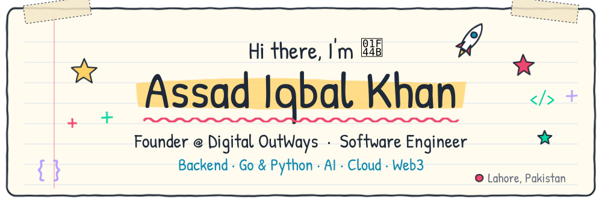
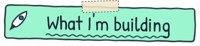
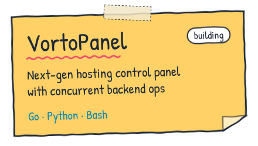
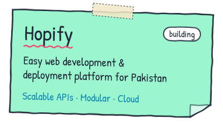
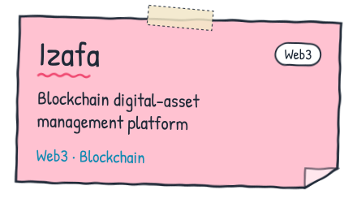
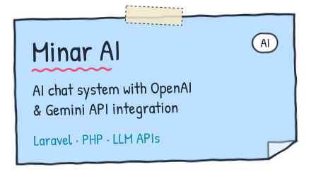
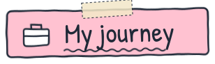
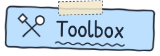
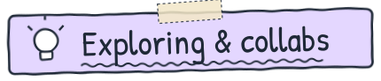
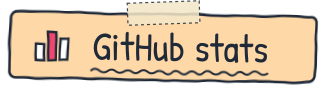

  

  

  
  
  
  
  

I'm a software engineer and founder from **Lahore, Pakistan** ✏️ with 5+ years across backend engineering, front-end development, technical support and teaching computer science.

I founded **[Digital OutWays](https://github.com/digitaloutways)** — a software engineering & AI company that helps startups and businesses design, build and scale digital products: custom software, AI & automation, and blockchain / Web3.

- 🧠 I like turning messy problems into clean, fast backend systems
- ⚡ Comfortable from the database up to the deployment pipeline
- 🎓 BS Software Engineering — Virtual University of Pakistan

<table>
  <tr>
    <td width="50%"></td>
    <td width="50%"></td>
  </tr>
  <tr>
    <td width="50%"></td>
    <td width="50%"></td>
  </tr>
</table>

| When | Role | Highlights |
|:--|:--|:--|
| 2025 → now | 🚀 **Founder** · Digital OutWays | Lead custom software, AI & automation, and blockchain projects; building Hopify & VortoPanel |
| 2022 → 2026 | ⚙️ **Backend Support Engineer** · Abacus | 99.9% uptime on enterprise-scale APIs · SQL/NoSQL query tuning · REST API validation |
| 2023 → 2024 | 🧑‍🏫 **Computer Science Teacher** · Nizami Science Academy | Built CS curricula and ran hands-on coding labs |
| 2021 → 2022 | 🧑‍🏫 **Computer Science Teacher** · The Arqam Schools | Live-coding lessons for grades 8–10, coding club mentor |
| 2021 | 🎨 **Front-End Developer** · B4USoft | +20% user engagement · 🏆 Employee of the Month |
| 2019 → 2021 | 🎧 **Customer Support Specialist** · ibex. | Technical support & problem-solving in a fast-paced team |

   
  

✏️ Go · Python · PHP · JavaScript · TypeScript · Java · Bash · Laravel · Node.js · Express · TensorFlow · Keras · Pandas · PostgreSQL · MySQL · MongoDB · Firebase · Docker · AWS · Azure · Git · Linux

<table>
  <tr>
    <td width="50%" valign="top">

**🌱 Currently exploring**
- Cloud-native backends in Go
- AI agents & automation
- DevOps pipelines
- Cybersecurity

</td>
    <td width="50%" valign="top">

**🤝 Open to collaborate on**
- Developer platforms & hosting tools
- AI chatbots and automation
- Blockchain / digital-asset products
- Tech for Pakistan's startup scene

</td>
  </tr>
</table>

  
  

  

Got an idea, a product to scale or a backend that needs fixing? 💬  
📫 **[asadiqbalkhan30@gmail.com](mailto:asadiqbalkhan30@gmail.com)** · 🌐 **[digitaloutways.com](https://digitaloutways.com)** · 💼 **[LinkedIn](https://www.linkedin.com/in/assad-iqbal-khan-735376166/)**

